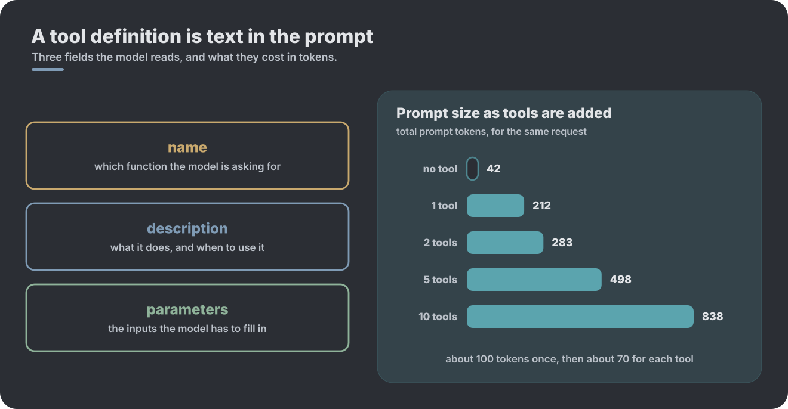

# Function-Calling and Data Extraction with LLMs: What the Model Sees, and How Far to Trust What Comes Back

*Article 3 of "From Transformers to Agents", my learning journey through AI.*

[Article 2](https://medium.com/@shimpali.deshpande/prompting-fundamentals-for-llms-getting-the-task-done-without-burning-your-usage-bb956a34a913) showed that a model's answer is your prompt, continued as plain text. That suits a person, who can read a paragraph and pick out what matters. A program can't do that. If your code needs a number or a list of claims from a model, it needs them in a form it can read reliably.

**Function calling** is how a model gives a program that kind of answer. It's also how a model asks a program to do something for it, like making an API call. The mechanism goes by two names. Anthropic's docs call it [tool use](https://platform.claude.com/docs/en/agents-and-tools/tool-use/how-tool-use-works). OpenAI's guide calls it [function calling](https://developers.openai.com/api/docs/guides/function-calling), or tool calling. We'll call it function calling in this article.

This article asks one question, in three parts:

1. When a model "calls" a function, who runs it?
2. What does the model read and write to make that happen?
3. How far can we trust what comes back?

To answer it, I built a small **Reader**. It takes a research paper's abstract and returns the paper's testable claims as JSON. At this point it's a plain Python script, which will be turned into an agent later in the series.

The Reader ran on ten arXiv papers, with a small open model, `granite4.2:3b`, running through [Ollama](https://ollama.com) on a Mac. Each paper has three reference claims, written from its abstract, so every result can be scored. Seven short scripts cover the three parts between them. Each ran once, so please read the numbers as observations and not benchmarks.


*The model never runs anything. It writes a request, and your code does the calling.*

## Series roadmap

This is article 3 of an 11-part series that works from DeepLearning.AI courses and independent sources, grouped into four sections:

1. **Foundation (understanding the basics)**: [how transformer LLMs work](https://medium.com/@shimpali.deshpande/how-transformer-llms-work-544f04f4d294), [prompting fundamentals](https://medium.com/@shimpali.deshpande/prompting-fundamentals-for-llms-getting-the-task-done-without-burning-your-usage-bb956a34a913), function-calling and data extraction (this article).
2. **Agentic AI deep dive (core patterns)**: agentic workflows, the four design patterns, reflection, tools, MCP and Agent Skills.
3. **Orchestration (connecting it all)**: planning and multi-agent systems, evaluating agents for production, the A2A protocol.
4. **Deployment & implementation (operating at scale)**: prompting multi-agent systems in practice.

## TL;DR

**How it works**

- **The model only writes a request.** It gives a function name and arguments. Your code runs the function and sends the result back.
- **A tool definition is text in the system prompt.** Every tool you offer costs tokens on every request, whether the model uses it or not.
- **A schema checks the shape of a reply, not whether it's correct.** When a reply fails the check, show the model the error and ask again, up to a set number of times. Never invent a result.

**What I measured**

- **Temperature changed how much the replies varied.** At temperature 1, every run gave a different reply. At temperature 0 the replies mostly repeated, but they weren't always identical.
- **A context window that was too small got the request refused.** Reading the paper one section at a time fitted in the window, but the model wrote far more tokens.
- **Hidden reasoning counted as written tokens.** Turning it off cut the tokens written to about a sixth.
- **LangChain's `function_calling` mode failed silently on 4 of 10 papers.** The model made no tool call, and LangChain returned `None` and no error.

## Research papers used for testing

The scripts print papers by their arXiv ID, so this list is the key for every output below.

1. `2310.13548`: [Towards Understanding Sycophancy in Language Models](https://arxiv.org/abs/2310.13548), by Sharma et al.
2. `2408.02442`: [Let Me Speak Freely? A Study on the Impact of Format Restrictions](https://arxiv.org/abs/2408.02442), by Tam et al.
3. `2501.10868`: [JSONSchemaBench](https://arxiv.org/abs/2501.10868), by Geng et al.
4. `2303.11366`: [Reflexion](https://arxiv.org/abs/2303.11366), by Shinn et al.
5. `2303.17651`: [Self-Refine](https://arxiv.org/abs/2303.17651), by Madaan et al.
6. `2302.04761`: [Toolformer](https://arxiv.org/abs/2302.04761), by Schick et al.
7. `2210.03629`: [ReAct](https://arxiv.org/abs/2210.03629), by Yao et al.
8. `2201.11903`: [Chain-of-Thought Prompting](https://arxiv.org/abs/2201.11903), by Wei et al.
9. `1706.03762`: [Attention Is All You Need](https://arxiv.org/abs/1706.03762), by Vaswani et al.
10. `2307.03172`: [Lost in the Middle](https://arxiv.org/abs/2307.03172), by Liu et al.

## 1. The model asks, your code runs

A function is a piece of your own code. The model can't run it, because all it can do is write text. So function calling works like a form, in four steps:

1. **Ask:** you describe the function to the model, along with your request.
2. **Write:** when the model decides it needs the function, it writes a request. That's a function name and the arguments to use.
3. **Run:** your program reads the request, runs the real function, and sends the result back as another message.
4. **Reply:** the model reads the result, and either answers or asks for another call.

[Anthropic's docs](https://platform.claude.com/docs/en/agents-and-tools/tool-use/how-tool-use-works#the-tool-use-contract) say it plainly: "The model never runs anything on its own. It emits a structured request, your code (or Anthropic's servers) runs the operation, and the result flows back into the conversation." Where it runs can differ. A few built-in tools, like web search, run on Anthropic's servers. Every tool in this article is the other kind, a **client tool**, so it runs in the code shown here.

Function calling does two jobs, and the Reader needs both:

- **Carry out a task:** the code runs a function and sends the result back, like fetching a paper.
- **Get a structured answer:** nothing runs, and the form the model fills in is the result, like claims as JSON.

> **A common mix-up:** the model doesn't call the function. It writes the request, and your code does the calling. The model never sees your implementation either. As [Anthropic's docs](https://platform.claude.com/docs/en/agents-and-tools/tool-use/how-tool-use-works#user-defined-tools-client-executed) put it, it only receives the schema you provided and the result you returned.

The Reader has two tools, both plain Python from `02_fetch_arxiv_by_hand.py`:

1. **`fetch_arxiv_sections`:** it downloads a paper and returns its section names.
2. **`get_section`:** it returns the text of one section.

The loop below is the whole mechanism. It asks the model, runs whatever the model requests, sends the results back, and stops when the model answers in text or the step cap is reached. It comes from `06_function_calling_by_hand.py`.

```python
for step in range(1, MAX_STEPS + 1):
    reply = ask_ollama_with_tools(messages, f"{arxiv_id} step {step}/{MAX_STEPS}")
    message = reply["message"]
    if message["tool_calls"]:
        messages.append({"role": "assistant", "content": message["content"],
                         "tool_calls": message["tool_calls"]})
        for call in message["tool_calls"]:
            name, args = call["function"]["name"], call["function"].get("arguments", {})
            tool_result, ran_ok = run_tool(name, args)  # our code runs it, never the model
            messages.append({"role": "tool", "tool_name": name, "content": tool_result})
        continue
    claims, error = parse_claims(message["content"])  # no tool call: the final answer, so validate it
```

This is a shortened output for one paper.

```
step 1/8: tool request (535 tokens in, 97 tokens out)
  code ran fetch_arxiv_sections({"arxiv_id": "2201.11903"})
step 2/8: tool request (763 tokens in, 83 tokens out)
  code ran get_section({"arxiv_id": "2201.11903", "name": "Abstract"})
step 3/8: text answer (1392 tokens in, 5666 tokens out)
```

On all ten papers, the model asked for both tools in the right order and copied the paper ID correctly. Two of the PDFs have no heading called Abstract. For the [ReAct paper](https://arxiv.org/abs/2210.03629) the model chose Start, which holds the abstract. For the [sycophancy paper by Sharma et al.](https://arxiv.org/abs/2310.13548), it chose the Introduction, which is longer.

What a tool sends back matters as much as what it does. `fetch_arxiv_sections` returns a short list of section names and not the whole paper (the [chain-of-thought paper](https://arxiv.org/abs/2201.11903) alone is 135,737 characters). That gives the model enough to choose its next call without filling up its input. The list also helped with the two PDFs that have no Abstract heading. The model could see the real section names and pick one, so it never asked for a section that wasn't there.

This model can reason privately before it answers. Ollama calls that thinking, and this article calls the text it produces hidden reasoning. With thinking on, 9 of the 10 papers finished with a valid answer. With thinking off, all 10 did. The section *Hidden reasoning: tokens you pay for and never see* explains the gap.

## 2. What the model sees: a tool definition is text

A tool definition has three fields:

1. **name:** it is what the model writes when it asks for the tool.
2. **description:** it says what the tool does and when to use it.
3. **parameters:** they list the inputs the model has to fill in, with their types, which ones are required, and optionally a default.

This is the definition of `get_section`, from the same script.

```python
{
    "type": "function",
    "function": {
        "name": "get_section",
        "description": "Return the text of one section of an arXiv paper, "
                       "for example Abstract or Introduction.",
        "parameters": {
            "type": "object",
            "properties": {
                "arxiv_id": {"type": "string",
                             "description": "arXiv ID such as 2408.02442"},
                "name": {"type": "string",
                         "description": "section name, for example Abstract"},
            },
            "required": ["arxiv_id", "name"],
        },
    },
}
```

### The system prompt

A system prompt is text placed before the conversation that sets the model's role and rules. The model reads it on every request, like everything else it is sent. The Reader's own instructions, "reply with JSON only, shaped like this", are a system prompt. Writing good ones for a group of agents that hand work to each other will be tackled in Article 11.

### Where tool definitions go, and what they cost

Tool definitions don't reach the model by a separate route. The chat template (the code that turns a conversation into the text the model reads) writes them into the system prompt as plain text. [Anthropic's docs](https://platform.claude.com/docs/en/agents-and-tools/tool-use/define-tools#tool-use-system-prompt) say the API "constructs a special system prompt from the tool definitions", and [OpenAI's guide](https://developers.openai.com/api/docs/guides/function-calling#token-usage) says function definitions count against the context limit and are billed as input tokens. The script `01_tools_in_the_prompt.py` shows this with the same small [Qwen2.5 tokenizer](https://huggingface.co/Qwen/Qwen2.5-0.5B-Instruct) as [Article 2](https://medium.com/@shimpali.deshpande/prompting-fundamentals-for-llms-getting-the-task-done-without-burning-your-usage-bb956a34a913). This is a shortened view of what the model reads when one tool is offered.

```
You may call one or more functions to assist with the user query.

You are provided with function signatures within <tools></tools> XML tags:
<tools>
{"type": "function", "function": {"name": "fetch_arxiv", ... }}
</tools>

For each function call, return a json object with function name and
arguments within <tool_call></tool_call> XML tags:
<tool_call>
{"name": <function-name>, "arguments": <args-json-object>}
</tool_call>
```

The script also counts the tokens in the prompt as it adds tools, from none to ten. The last column is how many tokens the tools added on top of the 42-token prompt with no tools.

```
tools  prompt tokens  added by the tools
    0             42                   0
    1            212                 170
    2            283                 241
    5            498                 456
   10            838                 796
```



*Measured with the Qwen2.5 chat template. Every tool you offer is read again on every request.*

The first tool adds 170 tokens, and about 100 of those are the instructions around the list. Each extra tool adds about 70. Other models have their own chat templates, which write these tool instructions in different words. So the exact token counts will differ from model to model. The pattern should stay the same, with a fixed cost once and then a cost for every tool.

> **A common mix-up:** it's easy to think a tool costs nothing until the model calls it. Every definition is prompt text, so it costs tokens on every request, whether the model uses it or not. The description is also where the model learns when to use a tool. Anthropic's [docs on defining tools](https://platform.claude.com/docs/en/agents-and-tools/tool-use/define-tools#best-practices-for-tool-definitions) call it by far the most important factor in how well a tool works, and ask for several sentences covering what the tool does and when not to use it.

## 3. Asking for a form: schema, validation and retry

The Reader has to return its claims in one fixed format. Every claim has three parts:

1. **`claim`:** the claim itself.
2. **`how_to_test`:** how to test it.
3. **`expected_result`:** the result to expect.

That format is written as a [Pydantic](https://docs.pydantic.dev/latest/) class, and the model is told to reply with JSON that fits it. Each reply then goes through three steps:

1. **Clean:** models often wrap their JSON in a code fence (a line of three backticks before and after it). The parser removes the fence, so only the JSON is left.
2. **Validate:** it checks the reply against the schema.
3. **Retry:** if the reply fails, the loop shows the model the error and asks again. The retries are capped.

This is that loop, from `03_extract_claims.py`.

```python
for attempt in range(MAX_RETRIES + 1):
    result = ask_ollama(messages, temperature, seed, num_ctx)
    claims, error = parse_claims(result["text"])
    if claims:
        return claims, stats
    messages += [{"role": "assistant", "content": result["text"]},
                 {"role": "user", "content": f"That was not valid: {error}. Reply with corrected JSON only."}]
return None, stats  # failed: never invent a result
```

The cap is the important part. A retry loop with no limit can run like an infinite loop on an input that never works. Here the limit is the first try, plus two retries. After that the paper is marked as failed, and the script doesn't make up a result in its place.

> **A common mix-up:** a reply that passes validation can still be wrong. The schema checks the format, meaning the fields and their types. It can't tell whether 91% is the right number. That needs a separate check. The reverse also happened in the context-window experiment, where a correct answer failed validation. The model wrote `expected_result` as the number 28.4, and the schema expects text, "28.4". Pydantic rejected the whole reply. One retry with the error shown fixed it.

Measuring accuracy needs answers to compare against. The test set is the ten papers listed under *Research papers used for testing*, with three reference claims each, written from the abstracts. Each reference claim has a short list of patterns (regular expressions that ignore upper and lower case). A reference claim counts as found when one of the extracted claims matches all of its patterns. For "[Reflexion](https://arxiv.org/abs/2303.11366) reaches 91% pass@1 on [HumanEval](https://arxiv.org/abs/2107.03374)" (91% of coding problems solved on the first try) the patterns are `91` and `HumanEval`.

This check compares facts and not wording, so a claim phrased differently still counts. It is strict about numbers. It can also miss a correct claim that uses words the patterns don't expect, so the score is a lower bound and the true number may be higher. Article 9 replaces this check with a model acting as judge. This is the output of `03_extract_claims.py`, run on the abstracts with thinking on.

```
paper       tries valid found tokens in tokens out seconds
2310.13548      1   yes   3/3       299       1881      37
2408.02442      1   yes   1/3       230       1676      31
2501.10868      1   yes   3/3       366       2150      40
2303.11366      1   yes   1/3       361       1652      31
2303.17651      1   yes   3/3       328       1599      29
2302.04761      1   yes   1/3       282       3275      62
2210.03629      1   yes   2/3       370       2370      44
2201.11903      1   yes   1/3       236       2048      38
1706.03762      1   yes   3/3       298       1448      26
2307.03172      1   yes   3/3       250       1492      27

claims found: 21/30  valid JSON: 10/10
```

- **Valid JSON was the easy part.** All 10 replies were valid on the first try, so no retry was needed.
- **Finding the claims was harder.** The Reader found 21 of the 30 reference claims. For four papers it found only 1 of the 3.
- **One early miss came from the script, not the model.** The script takes the abstract to be everything between the word "Abstract" and the Introduction heading. In the [chain-of-thought PDF](https://arxiv.org/pdf/2201.11903), a figure sits in that gap. It shows example maths questions about apples and tennis balls. So the model was handed the figure's text along with the abstract, and it extracted claims about apples and tennis balls. The fix was to end the abstract where the figure begins. So it's worth checking the input before doubting the model.

## 4. Three ways to get the form back

The Reader asks for the format in its prompt and then validates the reply. That's one of three ways to get a filled-in form:

1. **Ask, then validate:** this is the Reader's hand-written way from *Asking for a form: schema, validation and retry*.
2. **Enforce the format while the model writes:** this is **constrained decoding**. The model is only allowed to write text that fits the schema. Ollama does it through its `format` setting. [Its docs](https://docs.ollama.com/capabilities/structured-outputs#generating-structured-json-with-a-schema) say to give it a JSON schema, and they also advise putting the schema in the prompt. LangChain's [`with_structured_output`](https://reference.langchain.com/python/langchain-ollama/chat_models/ChatOllama/with_structured_output) with `method="json_schema"` sends your Pydantic schema as that setting.
3. **Offer the form as a tool:** this is the second job of function calling, getting a structured answer. LangChain's `function_calling` method offers the schema as a tool, and the model "calls" it. The filled form is the result.

All three ran on the same ten abstracts, with the same instructions, at temperature 0 and with thinking off. This is the LangChain call, from `07_langchain_structured_output.py`.

```python
llm = ChatOllama(model=MODEL, temperature=0, seed=1, num_ctx=8192, num_predict=MAX_OUT,
                 reasoning=False, keep_alive="10m")
structured = llm.with_structured_output(Claims, method=method, include_raw=True)
result = structured.invoke([("system", SYSTEM), ("human", abstract)])
# result["raw"] is the model's message, result["parsed"] is a Claims object or None
```

```
all 10 papers
method                     valid first try valid  found tokens out seconds
hand-written                         10/10 10/10  23/30       3661      71
LangChain json_schema                10/10 10/10  20/30       3611      63
LangChain function_calling            6/10  6/10   8/30       2014      43
```

Each method read the same ten abstracts. In the table, "valid" means the reply fitted the claims format, and "found" is how many of the 30 reference claims turned up.


*One run each at temperature 0, so a gap of a few claims is within the noise. The silent None is the part to remember.*

**The first two methods did about equally well.**

- The hand-written method and LangChain `json_schema` each returned a valid reply for all 10 papers.
- The hand-written method found 23 of the 30 claims, and `json_schema` found 20. The hand-written method found more on 3 papers, and the two tied on the other 7.
- Each method ran only once, so a gap of 3 claims is too small to say one is better.

**This test couldn't show the benefit of enforcing the format.**

- The point of `json_schema` is that the model can't write a badly formed reply, such as a number where text is expected.
- In this run the hand-written method never wrote a badly formed reply either. So there was nothing for that guarantee to prevent.

**LangChain `function_calling` failed on 4 of the 10 papers, and it failed silently.** This is what happened:

1. In this method, the model is supposed to answer by "calling" the form as a tool.
2. On 4 papers it didn't. It wrote the claims as ordinary JSON text in its reply. The text looked right, and began `{ "claims": [ { "claim": ...`.
3. LangChain only looks for a tool call. It found none, so it returned `None`, with no error and no warning. [Its source](https://github.com/langchain-ai/langchain/blob/a4b4a7b9a6d8b5eb2352e26e110f1b7beffc6f62/libs/core/langchain_core/output_parsers/openai_tools.py#L340-L341) confirms it. The parser LangChain uses here, [`PydanticToolsParser`](https://reference.langchain.com/python/langchain-core/output_parsers/openai_tools/PydanticToolsParser), returns `None` when there is no tool call to parse.
4. The `07_langchain_structured_output.py` script now prints what the model wrote in that case, so the failure can be seen.

**On the other 6 papers, its tool calls were short.**

- Five of the six were about 100 tokens, where the other two methods averaged about 360 tokens per paper.
- A shorter reply holds fewer claims, which probably explains why this method found only 8 of 30. That wasn't confirmed by counting the claims in each reply.

The lesson is about the silent failure. When a framework expects a tool call, check for the case where the model doesn't make one. Otherwise a missing answer looks the same as an empty one. The hand-written method doesn't have this gap, because it reads the model's text directly and the script does the validation itself.

> **Where sources differ:** researchers disagree on whether forcing a format makes a model's answers worse. [Tam et al. (2024)](https://arxiv.org/abs/2408.02442) found that models reasoned less well when they had to answer in a fixed format, and that a stricter format hurt more. [Geng et al. (2025)](https://arxiv.org/abs/2501.10868) built JSONSchemaBench to test constrained decoding. On three reasoning tasks with Llama-3.1-8B-Instruct, every framework they tested scored higher than the same model with no constraint. The two studies used different models, prompts and setups, so both results can be true. The small test here doesn't settle it. It found 20 claims with the format enforced and 23 without, and that gap is too small to count.

## 5. Temperature: the same prompt, different answers

[Article 1](https://medium.com/@shimpali.deshpande/how-transformer-llms-work-544f04f4d294) ended with the model giving a probability to every token that could come next. Temperature changes how the model picks from them:

- **At 0:** it always takes the most likely token.
- **At 1:** it picks at random, in proportion to the probabilities, like spinning a wheel where each token's slice is its probability.

Under the hood, temperature rescales the scores before they become probabilities, and 0 is treated as "take the top one".

Every pick becomes part of the text the next pick reads, as in [Article 1's](https://medium.com/@shimpali.deshpande/how-transformer-llms-work-544f04f4d294) loop. So if one early token is different, everything after it can be different too.

For three papers, the same extraction ran five times at temperature 0 and five times at temperature 1. Each run used a different seed, the number that starts the random picking. This is the core of `04_temperature.py`.

```python
for temperature in (0.0, 1.0):
    runs = [extract_claims(get_abstract(arxiv_id), temperature, seed) for seed in SEEDS]
    distinct = len({first_reply["text"] for _, first_reply, _, _ in runs})  # how many different first replies
```

```
paper       temp valid found agree distinct tokens out
1706.03762     0   5/5   3.0   5/5      1/5       1448
1706.03762     1   5/5   2.8   4/5      5/5       2299
2210.03629     0   5/5   2.0   5/5      2/5       2795
2210.03629     1   5/5   2.0   5/5      5/5       2622
2303.11366     0   5/5   1.8   4/5      2/5       1715
2303.11366     1   5/5   1.8   4/5      5/5       2464
```

- **At temperature 1, every run was different.** All five replies differed, on all three papers.
- **At temperature 0, the replies mostly repeated.** The [Attention paper](https://arxiv.org/abs/1706.03762) gave one reply across five seeds. The [ReAct](https://arxiv.org/abs/2210.03629) and [Reflexion](https://arxiv.org/abs/2303.11366) papers gave two different replies each.
- **JSON never broke at either setting.** All 15 runs at each temperature were valid on the first try.
- **The number of claims found barely changed.** The averages at temperature 0 and at 1 were 3.0 and 2.8, 2.0 and 2.0, and 1.8 and 1.8.

ReAct and Reflexion, the two papers with two replies at temperature 0, called for one more check. For each, the same prompt was sent five times with the same seed, and with the script's cache off so that every call was fresh. Both papers still gave 2 distinct replies out of 5. So temperature 0 makes the answers more alike, but it doesn't promise the same text. Finding the cause needs more tests and more runs. Numerical differences in the GPU maths are a first guess (still to be tested).

> **A common mix-up:** temperature 0 doesn't mean the same answer every time. It means the model always takes its most likely token. In this setup, even that gave different text on repeat calls.

One idea for later is to run the extraction three times and keep only the claims that show up in at least two runs. That would drop claims that appear only once. It wouldn't catch a claim the model gets wrong every time, because that claim would still win the vote. This idea is untested so far.

## 6. The context window: what shares it

The **context window** is the limit on how much text a model can work with in a single request. The limit is counted in tokens. Five things share it:

1. The system prompt.
2. The tool definitions.
3. The paper.
4. Earlier messages and tool results.
5. The model's own reply, including its hidden reasoning.

[Article 2](https://medium.com/@shimpali.deshpande/prompting-fundamentals-for-llms-getting-the-task-done-without-burning-your-usage-bb956a34a913) covered what a full window does to your usage. Here the question is simpler. Does a whole paper fit?

Two papers were read three ways each:

1. **small:** the whole paper, with the window set to 4,096 tokens.
2. **big:** the whole paper, with the window set to 20,480 tokens.
3. **sections:** the paper cut into sections, with one call each.

The [Attention paper](https://arxiv.org/abs/1706.03762) is 10,696 tokens by Ollama's count, and [Reflexion](https://arxiv.org/abs/2303.11366) is 16,639. The window size is one setting in the request, shown here from `05_context_window.py`.

```python
payload = {"model": MODEL, "messages": messages, "stream": False,
           "options": {"temperature": 0, "seed": 1, "num_ctx": num_ctx}}
if max_out:
    payload["options"]["num_predict"] = max_out  # stop a runaway call
```

Three columns in the output below need explaining:

- **`capped`:** calls stopped by the token cap, out of all calls made. `4/13` means 4 of 13 calls.
- **`bad`:** replies that failed validation.
- **`think`:** characters of hidden reasoning.

```
paper 1706.03762
how      found claims tokens in tokens out seconds capped   bad retry  think
small      0/3      0         0          0       0    0/1   0/1     0      0
  Ollama refused the call:
  request (10696 tokens) exceeds the available context size (4096 tokens)
big        2/3      5     21860       4413     194    0/1   0/1     1  12704
sections   3/3     36      8531      36429     731   4/13  4/13     0 123578

paper 2303.11366
how      found claims tokens in tokens out seconds capped   bad retry  think
small      0/3      0         0          0       0    0/1   0/1     0      0
  Ollama refused the call:
  request (16639 tokens) exceeds the available context size (4096 tokens)
big        2/3      4     16639       4117     181    0/1   0/1     0  12951
sections   1/3     31      9805      23217     479    1/9   1/9     0  81840
```

- **The small window was refused both times.** Ollama answered straight away with an `exceed_context_size_error`. The error gives the size of the request and the size of the window. A clear refusal is better than a silently shortened input.
- **The big window worked.** It found 2 of 3 claims on each paper. The run on the Attention paper needed one retry, because of the number written where text was expected, as described in *Asking for a form: schema, validation and retry*. The retry is why its tokens in are 21,860. The 10,696-token paper was sent twice.
- **Reading in sections wasn't more accurate.** It found 3 of 3 claims on the Attention paper and 1 of 3 on Reflexion, where the single big call found 2 of 3.
- **Reading in sections wasn't cheaper either.** The model read fewer tokens in total but wrote five to eight times more. It wrote 36,429 tokens against 4,413 on the Attention paper, and 23,217 against 4,117 on Reflexion. Every call repeats the instructions, and the model starts its hidden reasoning again each time.
- **Some section calls reached the 4,000-token limit on output and returned nothing usable.** That was 4 of 13 on the Attention paper and 1 of 9 on Reflexion.

With two papers, one run each and three reference claims per paper, these results can't show which way is more accurate. They do show two things:

- A whole paper needs a window bigger than 4,096 tokens.
- Reading in sections sends fewer tokens in, but makes the model write far more.

> **A common mix-up:** a bigger window isn't the same as better reading. [Liu et al. (2023)](https://arxiv.org/abs/2307.03172) found that models can use the start and the end of a long input better than the middle. That wasn't tested here. It's one more reason to hand the model only what the goal needs, as in [Article 2](https://medium.com/@shimpali.deshpande/prompting-fundamentals-for-llms-getting-the-task-done-without-burning-your-usage-bb956a34a913).

## 7. Hidden reasoning: tokens you pay for and never see

`granite4.2:3b` has thinking on by default. Its hidden reasoning isn't part of the reply, but Ollama's token counts include it. In the section-by-section run on the [Attention paper](https://arxiv.org/abs/1706.03762) above, the model wrote 123,578 characters of hidden reasoning. In the single whole-paper call it wrote 12,704. The tool loop from *The model asks, your code runs* ran twice:

1. **Thinking on:** this is the default.
2. **Thinking off:** the request carries `"think": false`.

In `06_function_calling_by_hand.py` that is one setting.

```python
if THINK is not None:
    payload["think"] = THINK  # --think off sends "think": false
```

The [sycophancy paper by Sharma et al.](https://arxiv.org/abs/2310.13548) shows the difference most clearly. This is the last step of its loop in each run.

```
thinking on:   step 3/8: done in 138 s, text answer
  (2121 tokens in, 6000 tokens out, thinking 21911 characters, HIT THE CAP)
thinking off:  step 3/8: done in 15 s, text answer
  (2118 tokens in, 677 tokens out, thinking 0 characters)
```


*Time follows the tokens the model writes, and the hidden reasoning counts as written tokens.*

- **The steps that ask for a tool were quick, with thinking on or off.** In the run on the [chain-of-thought paper](https://arxiv.org/abs/2201.11903), writing the first request took 2 seconds. The answer step took 124 seconds with thinking on.
- **Time depends on how many tokens the model writes.** On my Mac the speed was roughly 45 tokens a second, in tool steps and answer steps alike.
- **With thinking off, the ten papers took about a sixth of the tokens and the time.** The model wrote 4,794 tokens against 29,905, and took 112 seconds against 630.
- **The one failed paper ran out of output tokens.** The answer for the Sharma et al. paper ran into the 6,000-token cap with thinking on. With it off, the same step finished in 15 seconds.
- **Accuracy was about the same.** The loop found 18 of 30 claims with thinking on and 20 of 30 with it off, in one run each.
- **The section the model chose to read made a bigger difference.** With thinking off it read the Introduction of the [ReAct paper](https://arxiv.org/abs/2210.03629) and not its abstract, and found 1 of 3 claims where the other run found 2 of 3. The reference claims were written from the abstracts.

> **A common mix-up:** hidden reasoning can look free, because it never shows up in the reply. It is still counted as written tokens, and it takes time to write.

These results only cover reading an abstract and filling in a form. Whether thinking helps with planning, or with choosing between many tools, is still to be tested. Later articles will test it, because that's where it should matter most.

## The full scripts

The code blocks above are short excerpts. These are the seven complete scripts, in the order the article uses them. Each link opens the script as a notebook, with the output from the run reported here:

1. [`01_tools_in_the_prompt.py`](https://gist.github.com/shimpali/bebe6a3bf641ee3500bab3ab0cc6538a): What a chat template writes into the prompt when you offer tools, and the tokens it costs.
2. [`02_fetch_arxiv_by_hand.py`](https://gist.github.com/shimpali/2b6c5fea0c49171c14a13cf4e0833f0a): The Reader's two tools, written by hand. One fetches a paper, the other returns one section.
3. [`03_extract_claims.py`](https://gist.github.com/shimpali/ccd73bbb060517fd8a250f9ddfaede32): The Reader. It returns claims as validated JSON, retries with the error shown, and scores the result.
4. [`04_temperature.py`](https://gist.github.com/shimpali/cc4535dea2cf1a82ec77c406d3228fe8): Five runs at temperature 0 and five at 1, plus the same-seed check.
5. [`05_context_window.py`](https://gist.github.com/shimpali/aab670ee1f74ae44af6ba0f30a8507f1): Two papers read with a small window, a big window, and section by section.
6. [`06_function_calling_by_hand.py`](https://gist.github.com/shimpali/efe2118c91814c8c9e5fc0c67da9ff16): The tool loop, where the model asks and the code runs, with thinking on or off.
7. [`07_langchain_structured_output.py`](https://gist.github.com/shimpali/e1dd69afa5311fa5733b8c7a4b7e1305): The hand-written method next to LangChain's `json_schema` and `function_calling` methods.

## What's next

The Reader is the first piece of a lab I'm building across the series. The lab will be an agent that reads a paper and tests one of its claims on a small open model. So far it has three things:

1. Two tools.
2. A validated claims schema.
3. A test set of ten papers with thirty reference claims, which later articles will reuse.

Article 4 starts from the loop in *The model asks, your code runs* and builds a hand-written agent around it.

### Sources

- DeepLearning.AI, [Function-calling and data extraction with LLMs](https://www.deeplearning.ai/courses/function-calling-and-data-extraction-with-llms)
- Anthropic, [How tool use works](https://platform.claude.com/docs/en/agents-and-tools/tool-use/how-tool-use-works)
- Anthropic, [Define tools](https://platform.claude.com/docs/en/agents-and-tools/tool-use/define-tools)
- OpenAI, [Function calling](https://developers.openai.com/api/docs/guides/function-calling)
- Ollama, [Structured outputs](https://docs.ollama.com/capabilities/structured-outputs)
- LangChain, [ChatOllama.with_structured_output](https://reference.langchain.com/python/langchain-ollama/chat_models/ChatOllama/with_structured_output)
- LangChain, [PydanticToolsParser](https://reference.langchain.com/python/langchain-core/output_parsers/openai_tools/PydanticToolsParser) and its [source](https://github.com/langchain-ai/langchain/blob/a4b4a7b9a6d8b5eb2352e26e110f1b7beffc6f62/libs/core/langchain_core/output_parsers/openai_tools.py#L340-L341)
- Pydantic, [documentation](https://docs.pydantic.dev/latest/)
- Tam et al., [Let Me Speak Freely? A Study on the Impact of Format Restrictions on Performance of Large Language Models](https://arxiv.org/abs/2408.02442), 2024
- Geng et al., [JSONSchemaBench: A Rigorous Benchmark of Structured Outputs for Language Models](https://arxiv.org/abs/2501.10868), 2025
- Liu et al., [Lost in the Middle: How Language Models Use Long Contexts](https://arxiv.org/abs/2307.03172), 2023
- Chen et al., [Evaluating Large Language Models Trained on Code](https://arxiv.org/abs/2107.03374), 2021 (the HumanEval benchmark)
- Qwen team, [Qwen2.5-0.5B-Instruct](https://huggingface.co/Qwen/Qwen2.5-0.5B-Instruct) on Hugging Face

---

Diagrams and code in this article are my own. The Reader runs `granite4.2:3b` through Ollama on my Mac, and the token counts in the section on tool definitions use the Qwen2.5 tokenizer through Hugging Face `transformers` (5.17.0). Other pinned versions are `pydantic` 2.13.5 and `langchain-ollama` 1.1.0. Each number comes from one run, at temperature 0 unless the text says otherwise. Nothing is reproduced from the course, the docs or the papers.

<!-- medium:cut -->
## In this folder

| Path | What it is |
|---|---|
| [`function_calling_and_data_extraction_with_llms.ipynb`](function_calling_and_data_extraction_with_llms.ipynb) | The scripts below, run in order |
| [`scripts/01_tools_in_the_prompt.py`](scripts/01_tools_in_the_prompt.py) | What a chat template writes into the prompt when you offer tools, and the tokens it costs |
| [`scripts/02_fetch_arxiv_by_hand.py`](scripts/02_fetch_arxiv_by_hand.py) | The two tools by hand: fetch a paper, return one section |
| [`scripts/03_extract_claims.py`](scripts/03_extract_claims.py) | The Reader: claims as validated JSON, retry with the error shown, scored against the reference claims |
| [`scripts/04_temperature.py`](scripts/04_temperature.py) | Five runs at temperature 0 and at 1, and a same-seed check |
| [`scripts/05_context_window.py`](scripts/05_context_window.py) | Two papers: small window, big window, and section by section |
| [`scripts/06_function_calling_by_hand.py`](scripts/06_function_calling_by_hand.py) | The tool loop: the model asks, the code runs, with thinking on or off |
| [`scripts/07_langchain_structured_output.py`](scripts/07_langchain_structured_output.py) | Hand-written vs LangChain `json_schema` vs LangChain `function_calling` |
| [`reference_claims.json`](reference_claims.json) | The test set: three reference claims for each of the ten papers |
| [`results/`](results) | The numbers quoted above, one JSON file per script |
| [`images/`](images) | The 4 diagrams above, as standalone SVGs |
| `scripts/*.ipynb` | Code-only notebooks with output, published as the article's Gists |
| [`gist/`](gist) | One Gist ID and URL per script, kept in sync by `main.py --sync-gists`, see [`gist/GIST.md`](gist/GIST.md) |
